Guilherme Holanda Marques

Logs:

A primeira coisa que fiz foi importar o .md com o enunciado para o meu repo, assim minha consulta fica mais fácil, e o LLM que eu usar terá maior contexto.

Eu decidi prever o preço do dólar. Vou pedir para o Codex me gerar um CSV contendo dados sintéticos dos últimos 3 anos.

Enquanto o CSV é gerado, vou descrever como eu estou pensando na arquitetura. Vou iterar com ele até chegar em um resultado satisfatório, para gerar um código mermeid e colocar a imagem aqui.

O CSV ficou com 783 registros de 2023 a 2025, com data e preço do dólar em reais. Os valores são fictícios.

A versão inicial do prompt:
Gere um diagrama Mermaid para minha solução. Vou usar um container para treinar o modelo com o CSV e outro com um backend Python para fazer as previsões. Mostre como o modelo salvo chega ao backend e como a aplicação pede uma previsão.

A ideia é salvar o modelo em uma pasta compartilhada entre os containers. O backend vai carregar esse arquivo e usar os últimos 5 preços para prever o próximo. A aplicação vai pedir a previsão pela rota /predict, e a rota /health vai mostrar se o serviço está funcionando.

Esse é o plano que vou seguir nas próximas etapas:

```mermaid
flowchart LR
    dados["«artifact» CSV sintético USD/BRL<br/>data, fechamento"]

    subgraph treino["«executionEnvironment» Container de treinamento"]
        preparar["«component» Preparação dos dados<br/>Janelas de 5 fechamentos → próximo fechamento<br/>Divisão cronológica: treino e teste"]
        treinar["«component» Python / scikit-learn<br/>Treinar e avaliar modelo"]
        exportar["«component» Exportação com joblib<br/>Modelo e configuração das entradas"]
        preparar --> treinar --> exportar
    end

    modelo["«artifact» ./artifacts/modelo.joblib<br/>Pasta compartilhada no host"]

    subgraph inferencia["«executionEnvironment» Container de inferência / backend"]
        carregar["«component» Carregador Python<br/>Lê /app/artifacts/modelo.joblib na inicialização"]
        api["«component» API Python / FastAPI<br/>GET /health — estado do serviço<br/>POST /predict — previsão"]
        carregar -->|Modelo em memória| api
    end

    cliente["«component» Cliente via terminal<br/>Comandos curl"]
    dados -->|Leitura do histórico| preparar
    exportar -->|Grava em /app/artifacts<br/>bind mount de ./artifacts com escrita| modelo
    modelo -->|bind mount ./artifacts:/app/artifacts:ro<br/>Iniciar backend após exportação| carregar
    cliente -->|HTTP POST /predict<br/>JSON: últimos 5 fechamentos em ordem cronológica| api
    api -->|JSON: fechamento previsto em BRL/USD<br/>para a próxima observação| cliente
    cliente -->|HTTP GET /health| api
```

Revendo o diagrama, decidi usar só o terminal, com comandos curl para pedir as previsões e ver as respostas. Não vou fazer uma tela, De acordo com orientação do professor Murilo. Atualizei o diagrama com essa decisão.

Agora fui para o treinamento. Usei o Codex para criar o código de treino e os arquivos do Docker, e executar o treinamento. Usei regressão linear por ser um modelo simples. Ele recebe os últimos 5 preços e tenta prever o próximo. Separei 80% das amostras para treino e 20% para teste, mantendo a ordem das datas.

Um cuidado aqui foi não misturar as datas. Deixei os preços mais antigos no treino e os mais recentes no teste, para o modelo não usar o futuro para prever o passado.

Rodei esses comandos na pasta do projeto para criar a imagem e executar o treinamento:

docker build -f training/Dockerfile -t dolar-treinamento .
mkdir -p artifacts
docker run --rm -v "$PWD/data:/app/data:ro" -v "$PWD/artifacts:/app/artifacts" dolar-treinamento

O modelo ficou salvo em artifacts/modelo.joblib. O código também carregou esse arquivo de novo e confirmou que as previsões continuaram iguais.

O erro médio no teste foi de 0,0254 por dólar. Comparei com a ideia de só repetir o último preço, que teve erro de R$ 0,0255. Ficou praticamente igual. Como os dados são fictícios, isso serve para testar a solução, não para prever o dólar de verdade.

O modelo quase não melhorou em relação a repetir o último preço. Mantive essa versão simples porque o foco da atividade é fazer o treinamento e o backend funcionarem juntos.

As métricas ficaram em artifacts/metricas.json e as previsões do teste em artifacts/previsoes_teste.csv. Com o modelo pronto, o próximo passo é fazer o backend carregar esse arquivo.

Agora preparei o backend em Python com FastAPI, usando o Codex para criar o código e o Dockerfile. Ele carrega o modelo quando inicia. A pasta artifacts entra no container só para leitura.

Criei a rota /predict para receber os últimos 5 preços, do mais antigo ao mais recente, e devolver a previsão. A rota /health mostra se o serviço está ativo e com o modelo carregado. Tudo pelo terminal.

Rodei esses comandos na pasta do projeto:

docker build -f backend/Dockerfile -t dolar-backend .
docker run -d --rm --name dolar-backend -p 127.0.0.1:8000:8000 -v "$PWD/artifacts:/app/artifacts:ro" dolar-backend

Para conferir se estava funcionando:

curl http://localhost:8000/health
curl http://localhost:8000/predict -H 'Content-Type: application/json' -d '{"precos":[5.20,5.25,5.19,5.22,5.24]}'

O /health retornou {"status":"ok","modelo_carregado":true}. Com esses 5 preços, a previsão foi de R$ 5,2455 para o próximo dia da série. O Codex também comparou a resposta com o modelo salvo e deu o mesmo resultado.

Nos testes, entradas com quantidade errada de preços, preço negativo, texto, booleano ou sem os preços foram rejeitadas com erro 422. Sem o arquivo do modelo, o container não iniciou e avisou que precisava executar o treinamento e montar a pasta artifacts.

Esse teste sem o modelo mostrou um ponto importante: criar a imagem do backend não coloca o modelo dentro dela. Preciso passar a pasta artifacts no docker run, no caminho /app/artifacts, para ele encontrar o arquivo.

O backend ficou rodando na porta 8000. Para parar, uso docker stop dolar-backend. Para iniciar de novo, repito o comando docker run acima.

Agora fiz o teste da integração com ajuda do Codex. O backend já estava rodando no Docker com o modelo carregado. O treinamento já tinha terminado, então usei o terminal como cliente para pedir uma previsão.

Peguei os últimos 5 preços do CSV, de 25/12/2025 a 31/12/2025, e rodei:

curl -sS -w '\nHTTP %{http_code}\n' http://localhost:8000/health
curl -sS -w '\nHTTP %{http_code}\n' http://localhost:8000/predict -H 'Content-Type: application/json' -d '{"precos":[5.0291,4.9992,4.9904,4.9891,5.0724]}'
docker logs --tail 5 dolar-backend

O /health respondeu:

{"status":"ok","modelo_carregado":true}
HTTP 200

O /predict respondeu:

{"par":"USD/BRL","previsao":5.0846,"unidade":"BRL por USD","horizonte":"Próxima observação da série (segunda a sexta, incluindo feriados)"}
HTTP 200

Nos logs do container apareceu POST /predict HTTP/1.1 com 200 OK. Isso confirmou que o pedido saiu do terminal, chegou ao backend e voltou com a previsão de R$ 5,0846. É o valor previsto para o próximo dia da série sintética, não uma cotação real.
